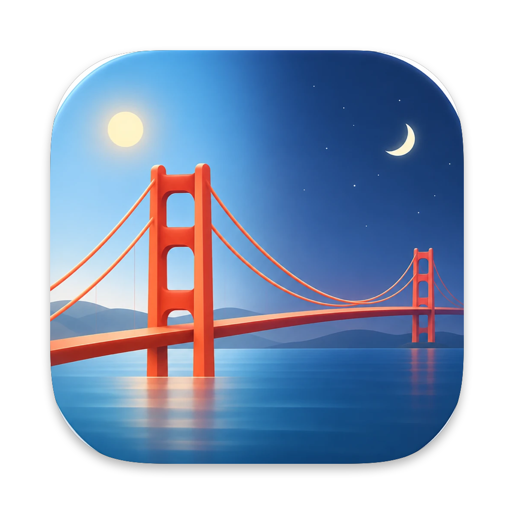
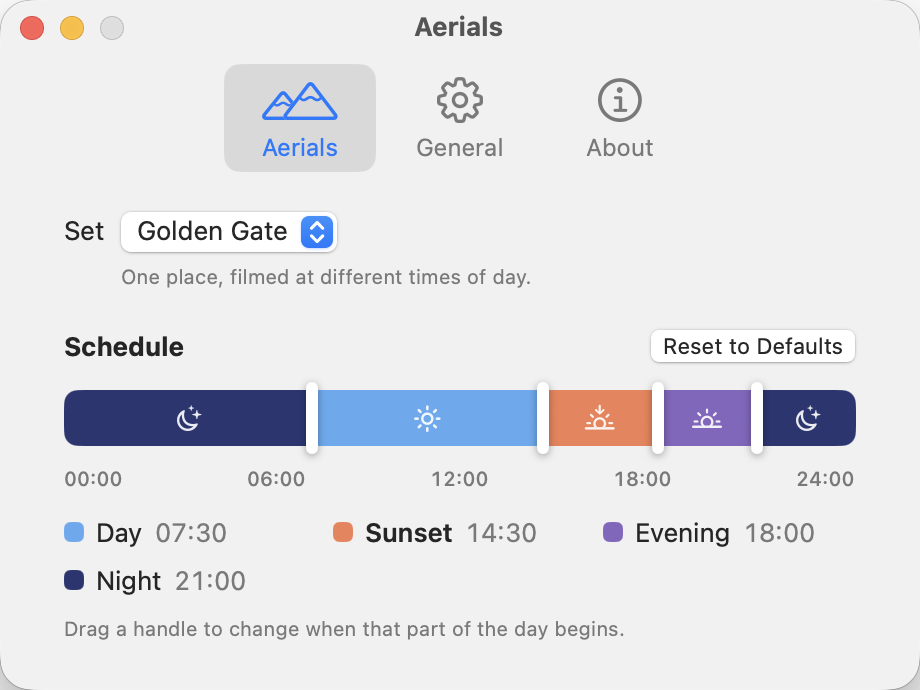

<p align="center">
  
</p>

<h1 align="center">Aerial Switcher</h1>

<p align="center">
  Let your Mac's Landscape Aerial follow the time of day.<br>
  <a href="README.zh-CN.md">简体中文</a>
</p>

---

macOS ships Landscape Aerials filmed at different times of day — Tahoe Morning, Day, Evening and Night; Sequoia Morning and Night; Golden Gate Day, Sunset, Evening and Night. But it never switches between them: you pick one and it stays.

Aerial Switcher is a small menu bar app that fills that gap. Pick a set, and your desktop shows its morning shot in the morning and its night shot at night.

<p align="center">
  
</p>

## Features

- **One set, on schedule.** Choose a set and the wallpaper changes as each part of the day begins. It also catches up when your Mac starts, wakes or you log in.
- **Your times.** Drag the handles on a 24-hour bar to set when each part of the day begins. By default the set's first shot starts at 06:00 and the rest follow the clock: day at 12:00, sunset at 17:00, evening at 18:00, night at 21:00.
- **Downloads what's missing.** Videos that aren't on your Mac yet are downloaded from Apple, so the desktop never falls back to the default wallpaper.
- **Easy to undo.** Pause to keep the Aerial showing now, or turn switching off to get back the wallpaper you had before — the one you picked most recently.
- **Stays out of the way.** A menu bar icon showing the current part of the day, and an optional Launch at Login.

The sets are found in macOS's own Aerial catalog, so new day-cycle sets from Apple show up on their own. Sets that aren't a day cycle, like Sonoma, aren't offered.

## Install

1. Download the latest `AerialSwitcher-x.y.z.zip` from [Releases](https://github.com/YnNJU/aerial-switcher/releases) and unzip it.
2. Move **Aerial Switcher** to your Applications folder and open it.
3. The app isn't notarized by Apple, so the first launch is blocked. Open **System Settings › Privacy & Security**, scroll down and click **Open Anyway**.

Requires macOS 15 or later.

## Use

On first launch the Settings window opens. Choose a set; any missing videos start downloading, and the wallpaper switches once the current one is ready.

From then on, the app lives in the menu bar. Its menu switches sets, pauses, turns switching on and off, and opens Settings. If the icon is hidden, behind the notch or a menu bar manager, open the app again to bring up Settings.

## How it works

macOS keeps the wallpaper choice in `~/Library/Application Support/com.apple.wallpaper/Store/Index.plist`. When it's time to switch, Aerial Switcher writes the next Aerial there and restarts `WallpaperAgent` so the change takes effect. Before taking over, it saves a copy of the file as you left it, which is what turning switching off puts back. If you pick another wallpaper yourself in the meantime, that one is kept instead.

Videos are downloaded from Apple's servers into the folder macOS uses for Aerials, `~/Library/Application Support/com.apple.wallpaper/aerials/videos`, just as System Settings would.

This relies on how macOS stores wallpapers today, which Apple doesn't document. A future macOS update could break it; if that happens, please [open an issue](https://github.com/YnNJU/aerial-switcher/issues).

## Build from source

With Xcode or the Command Line Tools installed:

```bash
git clone https://github.com/YnNJU/aerial-switcher.git
cd aerial-switcher
./scripts/bundle.sh
```

This builds a universal app into `dist/`. To run the tests:

```bash
swift test
```

With only the Command Line Tools, the testing plugin has to be pointed at explicitly:

```bash
swift test -Xswiftc -plugin-path -Xswiftc /Library/Developer/CommandLineTools/usr/lib/swift/host/plugins/testing
```

## License

[MIT](LICENSE)
