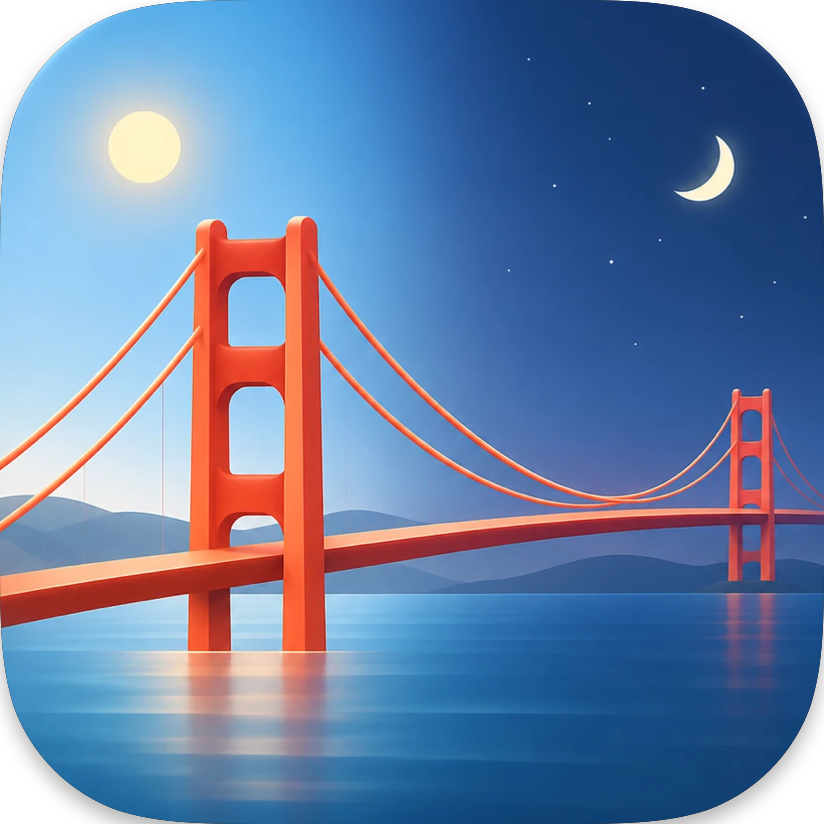
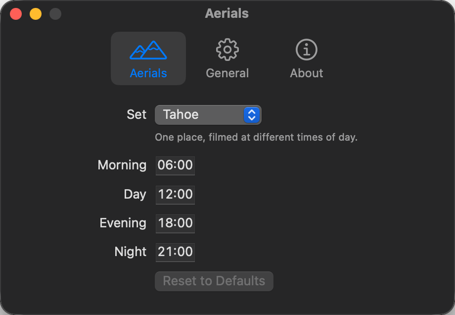

<p align="center">
  
</p>

<h1 align="center">Aerial Switcher</h1>

<p align="center">
  让 Mac 的风景航拍壁纸跟着一天的时间走。<br>
  <a href="README.md">English</a>
</p>

---

macOS 自带的风景（Landscape）航拍壁纸，很多是同一个地方在不同时段拍的：Tahoe 有清晨、白天、傍晚、夜晚，Sequoia 有清晨和夜晚，Golden Gate 有白天、日落、傍晚、夜晚。但系统从不在它们之间切换，你选了哪个，就一直是哪个。

Aerial Switcher 是一个小巧的菜单栏 App，专门补上这一块：选一组壁纸，早上桌面就是清晨那段，晚上就是夜晚那段。

<p align="center">
  
</p>

## 功能

- **一组壁纸，按时切换**：选好一组后，每到一个时段开始，壁纸就自动切换。开机、唤醒、登录时也会立即对齐到当前时段。
- **时间自己定**：每个时段的开始时间都可以改。默认第一段从 06:00 开始，其余按常见时间：白天 12:00、日落 17:00、傍晚 18:00、夜晚 21:00。
- **自动补齐视频**：还没下载到本机的视频，会自动从 Apple 下载，桌面不会退回默认壁纸。
- **随时撤回**：可以暂停切换，也可以一键恢复成原来的壁纸。
- **不打扰**：只有一个菜单栏图标，显示当前时段；可选开机自动启动。

可选的壁纸组直接读取自 macOS 的航拍壁纸目录，Apple 以后新增的同类壁纸组会自动出现。像 Sonoma 这种不是按时段拍摄的组不会列出。

## 安装

1. 从 [Releases](https://github.com/YnNJU/aerial-switcher/releases) 下载最新的 `AerialSwitcher-x.y.z.zip` 并解压。
2. 把 **Aerial Switcher** 拖进"应用程序"文件夹，然后打开。
3. 这个 App 没有经过 Apple 公证，第一次打开会被拦下。打开 **系统设置 › 隐私与安全性**，滚动到下方，点 **仍要打开**。

需要 macOS 15 或更高版本。

## 使用

第一次打开会弹出设置窗口。选一组壁纸后，缺少的视频会开始下载，当前时段的视频下好后壁纸就会切换过去。

之后 App 常驻在菜单栏，点图标可以暂停或打开设置。如果图标被刘海或菜单栏管理工具挡住了，再打开一次 App 就会弹出设置窗口。

## 原理

macOS 把壁纸设置存在 `~/Library/Application Support/com.apple.wallpaper/Store/Index.plist`。到了切换时间，Aerial Switcher 把下一段航拍写进这个文件，再重启 `WallpaperAgent` 让它生效。第一次修改前会先备份原文件，**恢复**用的就是这份备份。

视频从 Apple 的服务器下载，放进 macOS 存放航拍视频的目录 `~/Library/Application Support/com.apple.wallpaper/aerials/videos`，和在系统设置里点下载的效果一样。

这些做法依赖 macOS 目前存储壁纸的方式，Apple 并没有公开说明，以后的系统更新可能让它失效。遇到问题请[提 issue](https://github.com/YnNJU/aerial-switcher/issues)。

## 从源码构建

需要安装 Xcode 或命令行工具（Command Line Tools）：

```bash
git clone https://github.com/YnNJU/aerial-switcher.git
cd aerial-switcher
./scripts/bundle.sh
```

会在 `dist/` 下生成通用二进制（Universal）的 App。运行测试：

```bash
swift test
```

如果只装了命令行工具，需要手动指定测试插件的路径：

```bash
swift test -Xswiftc -plugin-path -Xswiftc /Library/Developer/CommandLineTools/usr/lib/swift/host/plugins/testing
```

## 许可证

[MIT](LICENSE)
